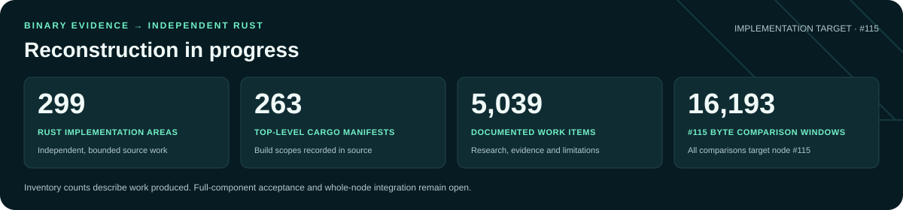

# Hyperliquid Source

**100% focused on node #115 — an independent, open-source Rust reconstruction.**

[Progress](#progress) · [Target](#target-node-115) · [Source availability](#public-source-and-private-changes) · [Get started](#get-started) · [Task queue](docs/TASKS.md)

The goal is a source-built Linux node that runs in Docker, connects to the
network, and synchronizes and validates chain state. This independent project
already contains bounded Rust implementations and substantial binary research;
an integrated, runnable node remains in progress.

## Progress

<!-- BEGIN GENERATED PROGRESS -->
<!-- Generated by make catalogue from the active #115 tree and authenticated evidence. -->



**297 active Rust implementation areas · 261 top-level Cargo manifests · 5021 #115 research work items.**

These inventory counts describe available work, not completed components.

### Completion percentages

| Measure | Completed / scope | Percentage |
| --- | ---: | ---: |
| Accepted full-scope gates | 69/92 | 75.00% |
| Complete node components | 0/23 | 0.00% |
| Components fully mapped | 23/23 | 100.00% |
| Components fully built | 23/23 | 100.00% |
| Components with full behavioral validation | 23/23 | 100.00% |
| Components with full code/data identity | 0/23 | 0.00% |
| Target .text bytes compared | 10,451,403/83,719,936 | 12.48377% |
| Target .text bytes raw-equal | 9,772,572/83,719,936 | 11.67293% |
| Target .text bytes relocation-qualified | 10,451,403/83,719,936 | 12.48377% |
| Whole-ELF bytes compared | 10,451,403/105,896,032 | 9.86949% |
| Whole-ELF bytes raw-equal | 9,772,572/105,896,032 | 9.22846% |
| First-party .text bytes compared | 546,700/83,719,936 | 0.65301% |
| Compared windows vs. `.eh_frame_hdr` unwind starts | 16,193/135,313 | 11.96707% |
| Component work areas with registered Rust paths | 23/23 | 100.00% |
| Active `src/` Rust areas registered in `components.json` | 297/297 | 100.00% |
| Research work items with top-level `MANIFEST.sha256` | 4,899/5,021 | 97.57% |
| Tracked research questions with reviewed evidence | 5/5 | 100.00% |

Gate percentages require acceptance of the full component scope.
Byte percentages cover the authenticated comparison registry, including dependencies;
they do not measure whole-node completion or remaining engineering effort.
Unwind starts (`make index`) are not a complete function census, and inventory/registration percentages do not claim component completion.

Registered bounded Rust work occurs in **23/23 component work areas**
(**297 implementation paths**, 100.00% of work areas). These are fragment registrations, not completed components.
Each fragment keeps its own #115 contract; an integrated node executable remains unaccepted.

<details open>
<summary><strong>Node #115 component acceptance</strong></summary>

**Node #115 reconstruction: 75.00% (69/92 accepted gates; 0/23 components complete).**

| Component | Target | Accepted gates | Milestones | Compared implementation bytes | Registered implementation windows |
| --- | --- | ---: | ---: | ---: | ---: |
| [Foundation utilities](docs/COMPONENTS.md#foundation) | Node #115 | 3/4 | 75% | 29,548 | 150 |
| [Serialization fork](docs/COMPONENTS.md#serialization) | Node #115 | 3/4 | 75% | 12,932 | 59 |
| [Storage and snapshots](docs/COMPONENTS.md#storage) | Node #115 | 3/4 | 75% | 4,980 | 26 |
| [Network transport](docs/COMPONENTS.md#transport) | Node #115 | 3/4 | 75% | 500 | 20 |
| [Consensus](docs/COMPONENTS.md#consensus) | Node #115 | 3/4 | 75% | 14,303 | 84 |
| [Node runtime and gossip](docs/COMPONENTS.md#node-runtime) | Node #115 | 3/4 | 75% | 1,700 | 27 |
| [Block execution and state](docs/COMPONENTS.md#abci) | Node #115 | 3/4 | 75% | 9,909 | 66 |
| [Action wire and signing](docs/COMPONENTS.md#action-wire) | Node #115 | 3/4 | 75% | 102,992 | 182 |
| [Action dispatch and handlers](docs/COMPONENTS.md#action-dispatch) | Node #115 | 3/4 | 75% | 35,135 | 15 |
| [Exchange orchestration](docs/COMPONENTS.md#exchange) | Node #115 | 3/4 | 75% | 12,507 | 57 |
| [Order books and matching](docs/COMPONENTS.md#orderbook) | Node #115 | 3/4 | 75% | 45,103 | 223 |
| [Clearinghouses and risk](docs/COMPONENTS.md#risk) | Node #115 | 3/4 | 75% | 29,233 | 151 |
| [Assets and fixed-point quantities](docs/COMPONENTS.md#assets) | Node #115 | 3/4 | 75% | 20,522 | 121 |
| [Fees and volume](docs/COMPONENTS.md#fees) | Node #115 | 3/4 | 75% | 11,425 | 86 |
| [Vaults and subaccounts](docs/COMPONENTS.md#vaults) | Node #115 | 3/4 | 75% | 15,070 | 84 |
| [Bridge and withdrawals](docs/COMPONENTS.md#bridge) | Node #115 | 3/4 | 75% | 27,629 | 79 |
| [HyperEVM execution](docs/COMPONENTS.md#evm) | Node #115 | 3/4 | 75% | 14,844 | 86 |
| [Staking and validator lifecycle](docs/COMPONENTS.md#staking) | Node #115 | 3/4 | 75% | 48,864 | 284 |
| [DEX registry](docs/COMPONENTS.md#dex-registry) | Node #115 | 3/4 | 75% | 62,123 | 152 |
| [Remaining L1 state helpers](docs/COMPONENTS.md#l1-shared) | Node #115 | 3/4 | 75% | 4,307 | 25 |
| [Info API](docs/COMPONENTS.md#info-api) | Node #115 | 3/4 | 75% | 10,575 | 79 |
| [EVM JSON-RPC](docs/COMPONENTS.md#evm-rpc) | Node #115 | 3/4 | 75% | 887 | 10 |
| [Global configuration](docs/COMPONENTS.md#constants) | Node #115 | 3/4 | 75% | 31,612 | 58 |

Accepted gates: **69/92**. Full-component byte and function denominators remain unmeasured.
Zero registered implementation comparisons do not mean zero correct code.

</details>

<details open>
<summary><strong>Node #115 binary comparisons</strong></summary>

Dependency windows count once in the target total and separately by source.
Their equality does not establish first-party or whole-node completion.

| Comparison | % of #115 `.text` | Raw matching bytes / compared | Raw-equal windows | Raw + relocation-qualified windows |
| --- | ---: | ---: | ---: | ---: |
| **Node #115 total** | 12.48377% | 9,772,572/10,451,403 (93.50%) | 817/16,193 (5.05%) | 16,193/16,193 (100.00%) |
| compiler-builtins | 0.00343% | 2,769/2,874 (96.35%) | 5/13 (38.46%) | 13/13 (100.00%) |
| native-libraries | 8.42793% | 6,597,469/7,055,854 (93.50%) | 617/9,342 (6.60%) | 9,342/9,342 (100.00%) |
| rust-alloc | 0.72038% | 564,066/603,100 (93.53%) | 26/830 (3.13%) | 830/830 (100.00%) |
| rust-core | 0.38205% | 297,298/319,855 (92.95%) | 44/808 (5.45%) | 808/808 (100.00%) |
| rust-std | 0.36727% | 289,752/307,482 (94.23%) | 24/534 (4.49%) | 534/534 (100.00%) |
| vendored-crates | 1.92681% | 1,509,467/1,613,120 (93.57%) | 88/2,540 (3.46%) | 2,540/2,540 (100.00%) |
| zstandard | 0.00289% | 2,418/2,418 (100.00%) | 2/2 (100.00%) | 2/2 (100.00%) |

Compared code: **10,451,403/83,719,936 .text bytes (12.48377%)**.

All active findings bind to node #115. See [detailed progress](docs/PROGRESS.md)
and [source-built node acceptance](docs/SCOPE.md#source-built-network-node).

</details>
<!-- END GENERATED PROGRESS -->

The [2026-11-09 post-merge evidence review](research/work-items/RE-001-node115-progress-review-2026-11-09/README.md#post-merge-refresh)
rechecks the merged-main snapshot: **6.35234% of target `.text` bytes compared,
5.93451% raw-equal, and 0.00% of full-scope gates accepted**. The earlier review
snapshots and unmatched results remain preserved.

## Target: node #115

**Node #115 is the only node implementation target**, authenticated by SHA-256
`a6e2897cd051213d004802deca416e8eca62b7a8278fa39f249e98c3867b5301`.
All active research, implementations, tests and PRs must advance this artifact.
Unvalidated retired work has been removed from the active tree and is recoverable
through Git history. [Migration provenance](research/migration.json) records the
retained shared helpers and the validated unsigned128 conversion and tagged-count migrations.

**100% focus does not mean 100% completion.** An integrated node, current-network
compatibility and whole-ELF reproduction remain open acceptance requirements.
The captured visor is an optional static-analysis smoke fixture, not a second
node implementation project.

## Public source and private changes

**The upstream libraries are public. The exact node-specific versions and
modifications are a separate question.**

- **Reuse public code:** [Rust and its core library](https://github.com/rust-lang/rust),
  [compiler-builtins](https://github.com/rust-lang/compiler-builtins) and
  [Zstandard](https://github.com/meta/zstd) have public source and licenses.
  Match their exact revision, options and integration instead of reinventing them.
- **Recover private changes:** the binaries contain paths for forks of bincode,
  Hyper/TLS and EVM-related dependencies. Those paths establish build inputs,
  not public availability of the exact fork source. Public upstream code alone
  does not establish the contents of those exact forks.
- **Reconstruct node logic:** consensus, state execution, matching and other
  unavailable native-node code need independently authored implementations.
  New implementation must be independently authored or reused under an
  applicable source license; inferred unlicensed code cannot be copied.

That is why dependency byte matches are reported separately from component
completion. They validate reused code and build provenance; they do not finish
consensus or order matching. Public contracts and companion data tools have their
own scope and are not extra native-node components to reconstruct.

## Next delivery milestones

1. Establish #115's exact dependency/fork inputs and validate every retained
   implementation against its actual #115 call, data and behavior contract.
2. Join startup, transport, peer handshake, storage and block validation into
   an actual source-built node with offline replay.
3. Validate the chosen current network, state synchronization, restart and APIs,
   then deliver a reproducible runtime Docker image.

Full-component acceptance, source/license closure and whole-ELF identity remain
separate requirements. See the [full release criteria](docs/SCOPE.md#source-built-network-node)
and [bounded task queue](docs/TASKS.md). The existing `.devcontainer` provides
research tools; it is not the node runtime image.

<details>
<summary><strong>Contribution and evidence requirements</strong></summary>

## Contribution focus

**All PRs, submissions and agent work must focus on completing the reverse
engineering of the node's code.** Contributions should hillclimb completion
through binary-backed findings, independently reconstructed Rust and validation
against the target. Show the concrete gap closed or evidence gained, even when
the result is partial and the component's acceptance gates remain unfinished.

Tooling, infrastructure, workflow and surrounding architecture changes are
accepted **only when an active reverse-engineering task is blocked**. Document
the blocker, make the smallest necessary fix, verify that the work can proceed,
and return to reverse engineering. **Window dressing, cosmetic cleanup and
inconsequential PRs or submissions will be closed**, as will supporting changes
without a demonstrated blocker. See [CONTRIBUTING.md](CONTRIBUTING.md) for the
acceptance policy and evidence requirements.

</details>

## Get started

Prerequisites: Git, Git LFS, Python 3.10+, ripgrep, GnuPG, GNU binutils
(`objdump` and `readelf` on PATH) and rustup. LLVM's `llvm-objdump` is useful
for further disassembly. On macOS, where `/usr/bin/objdump` is LLVM:

```sh
brew install git-lfs ripgrep gnupg llvm binutils rustup
export PATH="$(brew --prefix binutils)/bin:$(brew --prefix llvm)/bin:$PATH"
git clone --recurse-submodules https://github.com/lalalune/hyperliquid-source.git
cd hyperliquid-source
./scripts/setup.sh
make verify
make test
make catalogue-check
make doctor
make index
make reproduce
```

Setup installs Rust 1.94.1 and 1.95.0 via rustup, initializes pinned submodules,
and materializes Git LFS objects. It does not launch any captured executable.
For an existing clone, `make pull` materializes pinned source and binary inputs.
`make fetch` offers checksum-locked upstream recovery of missing artifact files;
mutable publisher URLs may no longer serve the pinned release, so LFS is preferred.

## Ghidra

The native analysis provider is Ghidra, accessed through pinned REA 6.8.0.
With Ghidra and a compatible JDK installed:

```sh
make rea-doctor                 # verify provider, Java and target availability
make rea-native-smoke           # decompile the visor entrypoint; reduced analysis
python3 tools/rea.py target 115  # verify the implementation target and full SHA-256
python3 tools/ghidra_plan.py --release 115  # print a digest-specific import command
```

For the desktop UI, set `GHIDRA_INSTALL_DIR` to your installation and run
`"$GHIDRA_INSTALL_DIR/ghidraRun"`. Keep projects under ignored `work/ghidra/`.
The smoke check performs static analysis; it does not run the captured binary
or establish full-node analysis or reconstruction completion. See
[REA setup and analysis profiles](docs/REA.md) and the
[scope and acceptance requirements](docs/SCOPE.md).

## Layout

- `artifacts/`: node #115, an optional visor analysis fixture, signatures and public key; binaries use Git LFS.
- `upstream/`: pinned official node tooling, contracts, block importer, EVM sync, order-book server and historical-data repositories.
- `tools/legacy/`: the preserved inventory parser required by reproducibility checks.
- `tools/artifacts.py`: integrity, download and isolated GPG verification.
- `research/imported/`: authenticated #115 and optional visor inventories and #115 dependency strings.
- `research/upstream-docs/`: collected documentation and repository inventories.
- `provenance/`: imported file hashes, artifact identities and source commit pins.
- `src/`: independently authored, bounded Rust reconstructions; no integrated node executable yet.
- `research/catalogue/`: generated #115 component map and byte-comparison records.
- `research/progress.json`: reviewed acceptance gates; `make catalogue` regenerates tables.
- `work/`: ignored output from local analysis, unwind indices and Ghidra projects.

See [research status](research/STATUS.md), [toolchains](docs/TOOLCHAINS.md),
[reproducibility](docs/REPRODUCIBILITY.md) and [third-party notices](THIRD_PARTY_NOTICES.md).
REA is pinned locally: see [REA setup](docs/REA.md) for `make rea-install`,
`make rea-doctor`, `make rea-smoke` and the existing Codex connection.

New project work is MIT licensed; imported materials retain their original terms.
