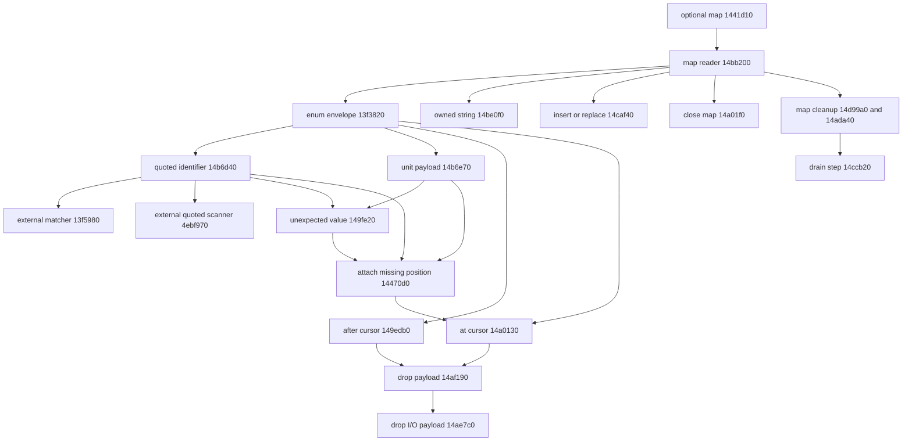

# RE-015: AwsName-keyed JSON maps, enum boundaries and failure ownership in node 94

This packet establishes an optional AwsName-to-string JSON map path: a reconstruction can implement null versus map results, quoted-key restrictions, duplicate-key replacement, failure cleanup and error precedence while keeping the enum envelope distinct from the inferred reference visitor.

- Component ID: `constants`; task `RE-015`, `global_constants/*`.
- Target release and full SHA-256: node #94, `3b7179cd967d1b13b683e05debfc685ad4c750e918226402d5d575eff1c0459f`.
- Source commit / reference commit: repository `56c0ec672bd8fdcfaa80f2db700a61e6240b3663`; inferred reference `999556f6e0a474b8312db96ec3149e1c44e97c23`.
- Claim status: byte/FDE/relocation/LSDA observations and explicitly bounded control-flow inferences. No target execution, reconstructed Rust, equivalence or component gate claim.
- Scope included and excluded: the optional-map entry, map reader, enum entry, identifier adapter, unit checker, owned-string reader, insertion/replacement, drain/drop helpers, close checker, wrong-type classifier, position constructors, position repair and expected-type writers. Existing matcher/quoted-scanner/number/allocator bodies, nonempty-node split/rebalance machinery, the configuration file loader, initialization/default selection, top-level trailing-input checks and other artifact targets are excluded.

## Reproduce

From the repository root with the pinned binary present, using Python 3.12.3 and the standard library:

```sh
python3 tools/aws_json_envelope94.py --out research/work-items/RE-015-aws-json-envelope-94
python3 -m unittest tests.test_aws_json_envelope94
python3 tools/artifacts.py verify
python3 tools/catalogue.py --check
python3 tools/reproduce.py
python3 tools/verify_imports.py
```

The final command has an environment failure recorded below. The collector uses the repository's `elf_index.sections` and `fde_extents.eh_frame_records`/`uleb`. It hashes the binary before parsing, rejects a different digest, and reads file-backed allocated sections, excluding SHT_NOBITS. It has no external-program or captured-binary execution path. Its deliberately restricted instruction reader is derived from the independently authored MIT configuration-number research collector; ELF and unwind parsing are not duplicated.

For two independent output directories, substitute relative writable directories for the placeholders:

```sh
PYTHONHASHSEED=7 TZ=UTC python3 tools/aws_json_envelope94.py --out <tmp-dir-one>
PYTHONHASHSEED=91 TZ=Pacific/Honolulu python3 tools/aws_json_envelope94.py --out <tmp-dir-two>
diff -r <tmp-dir-one> <tmp-dir-two>
```

Both generation passes and the focused tests were also checked with a PATH containing only Python, without binutils. Nine generated files are compared byte-for-byte. `README.md` and `MANIFEST.sha256` are documentation/integrity records, not collector outputs. The manifest hashes every other file in this evidence directory. GNU objdump 2.42 was used for human inspection only; none of its output is parsed or included in generated evidence.

## Evidence

All addresses below are linked ELF virtual addresses; ends are exclusive. JSON/TSV addresses are decimal VAs, with instruction file offsets also retained in `evidence.json`. FDE extents are unwind-described ranges, not a whole-binary function census. The collector partitions every selected range into admitted instruction encodings and checks exact body digests, internal direct-branch boundaries, table targets and relocation addends. It finished all selected ranges without truncation.

| Inferred role | Entry | FDE end | Bytes |
| --- | --- | --- | ---: |
| enum envelope | 0x13f3820 | 0x13f3dca | 1450 |
| expected identifier | 0x1401120 | 0x1401139 | 25 |
| optional name map | 0x1441d10 | 0x1441e7f | 367 |
| attach missing position | 0x14470d0 | 0x1447125 | 85 |
| error after cursor | 0x149edb0 | 0x149ee68 | 184 |
| unexpected value | 0x149fe20 | 0x14a0127 | 775 |
| error at cursor | 0x14a0130 | 0x14a01f0 | 192 |
| map close | 0x14a01f0 | 0x14a02a3 | 179 |
| drop map result | 0x14ada40 | 0x14adb7f | 319 |
| drop io payload | 0x14ae7c0 | 0x14ae889 | 201 |
| drop error payload | 0x14af190 | 0x14af1bc | 44 |
| quoted identifier | 0x14b6d40 | 0x14b6e63 | 291 |
| unit payload | 0x14b6e70 | 0x14b6f9a | 298 |
| name string map | 0x14bb200 | 0x14bb857 | 1623 |
| owned string value | 0x14be0f0 | 0x14be248 | 344 |
| expected map | 0x14c3eb0 | 0x14c3ec9 | 25 |
| expected unit | 0x14c3ef0 | 0x14c3f09 | 25 |
| expected string | 0x14c3f10 | 0x14c3f29 | 25 |
| map insert or replace | 0x14caf40 | 0x14cb137 | 503 |
| map drain step | 0x14ccb20 | 0x14ccecd | 941 |
| drop name string map | 0x14d99a0 | 0x14d9a64 | 196 |

The name attribution is an inference from the identifier adapter's direct call at `0x14b6e0a` to the already documented AwsName matcher `0x13f5980`. That matcher is an external boundary, not a newly selected function. None of the selected entries appeared in the existing evidence or the available relevant draft bodies. The original constants packet and its prefix/xref corrections already own the file-selection/default path; this packet does not resubmit their name table or their functions.



The two edges into payload drop are exception cleanup edges, established by LSDA call-site ranges rather than ordinary fall-through. `calls.tsv` and `exception-sites.tsv` retain the distinction and all transfer sites. Expected-type writers are linked by relocated vtable slots, not direct calls.

### Optional-map entry and actual key boundary

`0x1441d10` skips JSON whitespace and recognizes a `null` prefix before dispatching other inputs to the map reader at `0x14bb200`. It publishes a qword result tag: 0 for the null arm, 1 with the map payload for successful map parsing, and 2 with an error pointer for failure. Null truncation and suffix mismatches use codes 5/9 through the at-cursor constructor. Like the enum entry, this wrapper does not enforce end-of-document after its value.

The map reader requires `{`, decrements cursor depth and begins an empty local collection. Its key loop accepts an immediate `}` for an empty map, distinguishes the first key from subsequent comma-separated keys, and checks quote at `0x14bb39f` before calling the enum entry at `0x14bb3ac`. Thus this observed caller exposes only the quoted arm of the enum envelope. The enum's tagged-unit-object arm is not a permitted key shape through this call site. This restriction would be lost by replacing the key reader with the generic envelope unconditionally.

After a successful key, the reader requires and consumes `:`, calls the owned-string reader at `0x14bb42a`, then passes the key byte and string triple to `0x14caf40`. The value reader uses the same external quoted scanner, allocates/copies its result, and publishes capacity/pointer/length at offsets 0/8/16. An empty string uses pointer 1 and zero length without allocating. Its failure sentinel is the high bit in the capacity word, with an error pointer at +8; the map reader checks that sentinel before insertion. The external copy relocation is a GLOB_DAT symbol named `memcpy`, not a guessed linked function address.

The first-key flag rejects an initial comma; after a value, a missing comma yields code 8. A comma followed by `}` yields code 21, another unquoted key yields code 17, and a wrong colon yields code 6. EOF cases have separate code 3/5 routes in `error-routes.tsv`. The reader does not silently skip unknown AwsName keys; it propagates the existing matcher's error.

### Mutation, duplicate keys and failure precedence

The insert helper searches keys as zero-extended bytes. The observed B-tree node layout uses a 16-bit key count at +274, key bytes beginning at +276, and 24-byte string slots beginning at +8. A matching key copies the old string triple to the helper's output and overwrites that slot with the new triple at `0x14cafd3` through `0x14cafed`; it bypasses collection count increment. The map reader releases the returned old string when its capacity is nonzero. A duplicate key therefore replaces its previous value, rather than taking a duplicate-field error branch.

For an empty tree, the helper allocates a 288-byte leaf, initializes root/height and node count, checks the observed capacity bound 11, writes the key/string slot and increments collection length at `0x14cb0c7`. The returned high-bit sentinel indicates no old value. Insertion into an existing nonmatching leaf delegates to `0x13a1290` before the same length increment. That helper's splitting/rebalancing and allocator internals are explicit external boundaries; this packet does not claim complete B-tree equivalence.

On a key/value/syntax error, the reader drains already accumulated strings before restoring its own depth and calling the close checker at `0x14a01f0`. This differs from the enum object's early errors, which bypass its depth restoration. The drain iterator decrements its remaining count, walks child/parent links, returns node/index locations for string cleanup, and releases exhausted nodes using the observed 288-byte leaf/384-byte internal sizes. A terminal zero node ends the value-drop loop. Invalid iterator-state branches terminate through the recorded panic target; no arbitrary-corruption safety claim is made.

After depth restoration the reader always checks closure for an opened map. If a prior parse error exists, it releases any newly returned closing error and keeps the earlier error, then repairs its position if absent. If parsing succeeded but closing fails, it drops the successfully accumulated map and returns the closing error. A successful close publishes the map with tag zero. `drop_map_result` selects map-drain versus error-box cleanup by the result tag, with LSDA cleanup for the I/O-payload destructor path.

The added CFG propositions check that key/value failures cannot reach normal return without the reader's restore store, accumulated-map cleanup precedes its join, successful-map close failure passes through map drop, duplicate replacement can return without count increment, and fresh-leaf insertion cannot. They do not assert that every structural path is feasible for valid inputs.

### Entry partition and result publication

At `0x13f3853`/`0x13f388e`, the comparison immediate is `0x22`; the alternative compare at `0x13f38c4` is `0x7b`. The mask at `0x13f3844` has bits 9, 10, 13 and 32 set. `entry_partition` in the JSON covers all byte values: those whitespace bytes loop, quote calls the identifier adapter, `{` enters the object arm, and every other available byte reaches code 10 at `0x13f3d62`. An exhausted cursor reaches code 5. In particular, `[` does not enter a sequence visitor here.

The cursor object uses pointer/length/cursor fields at offsets `0x18`, `0x20`, `0x28` and a byte at `0x48` used as remaining nesting depth. The output uses a byte tag at `+0`, a success value byte at `+1`, and an error pointer at `+8`. Tag zero is success; tag one publishes the pointer. These are layout observations for these machine-code entries, not a stable Rust ABI declaration.

The quoted path reads the matcher's byte and uses signed-rel32 entries at `0x217910`. Each table target is a distinct in-body code leaf that writes the same index to output `+1`, clears EAX and joins the tag store at `0x13f398a`. The generated 76 code-leaf edges establish identity propagation inside this newly selected envelope. They contain no variant spellings and do not recreate the old 76-name/discriminant inventory. The entry does not independently range-check a successful matcher byte; validity of the matcher result is an external precondition.

### Tagged object: ordering is observable

The `{` branch tests the incoming depth byte for zero before decrementing it. Zero reaches the arithmetic panic path at `0x13f3da3`. A nonzero byte is decremented and stored at `0x13f38db`; a resulting zero returns code 24 before consuming `{`. Otherwise the cursor advances past `{` and the same identifier adapter runs.

After a successful identifier, the envelope skips whitespace, requires `:`, consumes it, and calls the unit checker. The unit checker requires `null`, returning zero on success. An identifier error, missing/wrong colon, or unit error returns without restoring the decremented depth. No rollback should be inferred from a high-level recursive parser design.

After unit success, `0x13f399a` writes the value byte and `0x13f399e` writes tag zero. The depth increment/store at `0x13f39b1`/`0x13f39b3` occurs before the final whitespace scan and `}` comparison. A missing/wrong close subsequently overwrites the output tag with one and stores an error pointer; the previously written value byte is inactive. Successful `}` consumption writes the value byte again and returns tag zero. No trailing-input check follows inside this entry.

The JSON includes 17 normal-return CFG propositions with witness paths or an absent path under a forbidden-node constraint. They establish the early-error paths that bypass restoration and the late-close paths that require it. These are structural reachability/dominance claims, not symbolic input executions. Opaque callees are assumed to return normally; fixed panic/unwind targets terminate those paths.

### Identifier, unit and wrong-type handling

The identifier adapter consumes the opening quote, resets scratch length at cursor `+0x10`, and calls the existing quoted scanner through RELATIVE slot `0x576eca0` (addend `0x4ebf970`). Scanner status 2 propagates an error without invoking the matcher. Other statuses feed the string pointer/length to `0x13f5980`; matcher tag one goes through position repair, while success publishes the value byte unchanged. Escape and unknown-name behavior remain dependencies of those external bodies.

The unit check compares `n`, `u`, `l`, `l` at `0x14b6edd`, `0x14b6f07`, `0x14b6f1f`, `0x14b6f37`. Cursor stores precede each suffix comparison. Truncation yields code 5 and a mismatching suffix yields code 9, both through the at-cursor constructor. A non-`n` value goes to the wrong-type classifier, with expected text `unit`.

The classifier's signed-rel32 table at `0x21b6d4` spans bytes 91 through 123. It distinguishes `false`, `true`, `null`, `[` and `{`; quoted strings, minus and decimal digits are separate branches. Complete literals build type-descriptor tags 0 with a boolean byte, or 7 for unit. Arrays/maps build tags 10/11 without consuming their opener. The string path builds tag 5 after the shared scanner succeeds. Numeric paths call external `0x149f7b0`, passing zero after consuming minus or one for a leading digit; numeric tag 3 propagates its error. Numeric conversion and external error formatting are not reconstructed here.

Expected identifier vtable `0x566e8d0` resolves its `+24` slot to `0x1401120`, whose pointer/length operands select the 18 bytes `variant identifier` at `0x264f73`. Expected unit vtable `0x566e950` similarly resolves to `0x14c3ef0`, selecting the four bytes `unit` at `0x209d40`. The map and string adapters additionally use relocated writers `0x14c3eb0` and `0x14c3f10` for the slices `a map` and `a string`. These are complete length-delimited pool slices, not zero-terminated-string assumptions. The writers tail-call a dynamic formatter method; its sink behavior is unresolved.

### Syntax routes and positions

The enum/helper subset below contains observed payload stores; the complete 29-route table, including optional-map, map and close-checker failures, is generated in `error-routes.tsv`. Human error names are deliberately not substituted for the external constructor's definitions.

| Route | Store VA | Code | Position constructor |
| --- | --- | ---: | --- |
| empty envelope after whitespace | 0x13f3873 | 5 | after |
| colon absent at EOF | 0x13f3951 | 3 | after |
| close absent at EOF | 0x13f39f3 | 3 | at |
| wrong envelope start | 0x13f3d62 | 10 | after |
| exhausted object depth | 0x13f3d6f | 24 | after |
| wrong colon | 0x13f3d7c | 6 | after |
| wrong close | 0x13f3d89 | 10 | at |
| truncated unexpected literal | 0x14a0045 | 5 | at |
| invalid unexpected literal | 0x14a0093 | 9 | at |
| invalid unexpected start | 0x14a00f8 | 10 | after |
| empty identifier after whitespace | 0x14b6da6 | 5 | after |
| empty unit after whitespace | 0x14b6ec4 | 5 | after |
| truncated null | 0x14b6f44 | 5 | at |
| invalid null suffix | 0x14b6f5d | 9 | at |

`after` (`0x149edb0`) guards cursor increment overflow and counts the prefix ending at `min(cursor + 1, length)`. `at` (`0x14a0130`) rejects cursor greater than length and counts the prefix ending at cursor. Both start at line 1, column 0, increment line/reset column on byte 10 and increment column for any other byte. They count bytes, not Unicode scalar values; CR is not a newline in these loops. Line/column increments have overflow panic branches. The final constructor is the external RELATIVE target `0x4ebcd70` through slot `0x576ef80`.

Position repair tests the qword at error-box `+24`. Nonzero returns the existing box unchanged. Zero invokes the at-cursor constructor with the existing payload, then releases the old 40-byte box. Its LSDA landing pad also releases that box before resuming unwind. The interpretation of `+24` as a line field follows the constructor call convention and this zero/nonzero gate; the external allocation layout itself is not re-derived.

### Cleanup and exceptional edges

The two position constructors have LSDA ranges leading to payload drop when their checked counter/range paths unwind. Payload tag zero conditionally releases pointer `+8` using size `+16`. Otherwise low-32-bit tag one tail-calls the I/O-shaped drop helper on payload `+8`; other tags return without that release.

The I/O helper tests the low two pointer bits for one. Only that encoding subtracts one, reads object/vtable pointers, conditionally calls the vtable destructor, conditionally frees a nonzero-sized object, and frees the 24-byte outer allocation. Its landing pad performs the corresponding frees after a destructor unwind. The allocator target is recorded, but its implementation and the dynamic destructor are external. The JSON separately lists external static targets, dynamic symbol slots, unresolved register-indirect sites and assumed nonreturning targets. Action indices and type-table bases are retained from LSDA; catch/filter type semantics are unresolved. The evidence does not invent exception edges in the normal-return CFG.

## Implementation and comparison

Independent Rust reconstruction: **not yet implemented**. Cargo lock, compiler/linker flags, two-build result, raw/normalized binary comparison and whole-ELF equivalence: **not yet measured**. No normalization masks or reference implementation bytes were used. The new Python code is an evidence collector, not a substitute node implementation.

The inferred reference's `AwsName` visitor accepts a sequence and has an object-field/default route. This selected machine-code entry instead rejects `[` at the envelope boundary and uses an externally tagged unit-object arm. That is a concrete reason not to assign the reference visitor wholesale to this address. It does not prove every other AwsName caller rejects sequences, nor re-establish file fallback behavior. The already-owned loader and matcher remain separate questions.

The 19 focused unittest methods cover exact target identity and body coverage; wrong digest; negative/out-of-file/NOBITS/ambiguous ranges; truncated/unsupported encodings and branch interiors; whitespace/delimiter/depth mutations; remapped/duplicate/out-of-body code-table targets; classifier boundary mutation; call/vtable relocation and literal mutation; an otherwise unmodelled body change; CFG restoration bypass; syntax-position distinctions; LSDA header/range/landing corruption; operand changes; changed/duplicate FDEs; the complete entry-byte partition; map count/replacement/cleanup contracts and GLOB_DAT-symbol corruption; signed search sentinels and SIMD register classes; and exact regenerated-file equality. Inner corruption tests intentionally bypass only the outer digest so structural checks are actually exercised. No test skips or target execution are used.

## Results and limitations

`evidence.json` reports 21 selected FDE ranges, 8,092 bytes, 2,061 decoded instructions, 380 direct branch sites, 130 call-or-indirect-transfer sites, 266 explicit memory store/update sites, 29 syntax error routes, 8 LSDA tables and 38 LSDA call-site ranges. These denominators describe this selection only. The store count includes admitted scalar/SIMD moves and memory increment/decrement, excluding implicit stack writes; the transfer count includes indirect jumps and direct calls, with direct tail jumps retained in the branch table.

Validation passed: 19 focused tests with zero skips; two deterministic generations and byte comparison; artifact hashes/signatures; catalogue check; inventory/literal reproduction. `verify_imports.py` failed when Git LFS's clean filter attempted a temporary write under read-only Git metadata during its fresh-index status check. The ordinary pinned-reference HEAD/status reads succeeded. No permission or infrastructure change was made to mask that failure. Whole-repository tests, hosted CI, Rust builds and runtime comparisons were not run.

The available open/merged-PR context was checked, including the configuration-number, plain-name-codec, HlChain-reader and existing static-config parser packets. A live public-main refresh failed because the configured connection was unavailable; current public-head/PR freshness remains a submission-time check. No selected function is re-exported from those packets, but shared callees are named as dependency boundaries.

This is a bounded path packet, not completion of the component's first task or a guaranteed grading tier. External matcher validity, string escapes, numeric conversion, error allocation/formatting, dynamic destructor behavior, caller reachability beyond the selected optional-map entry, nonempty-node split/rebalance, initialization/default publication and whole-artifact closure remain open. No progress gate is requested; the constants component remains at its existing gates.

Next question: which named configuration field reaches the optional-map entry, what cursor/depth invariants does its caller establish, and where does complete-document consumption precede global-state publication?
