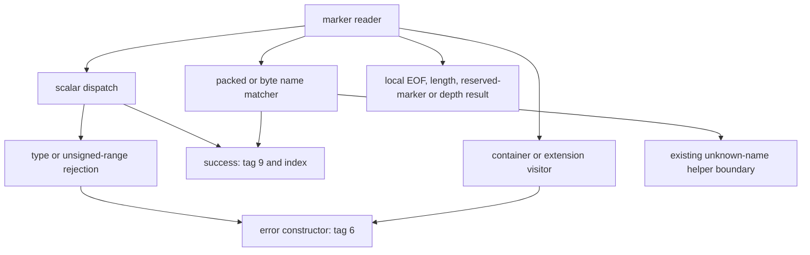

# RE-015: recover the node #94 HlChain reader and its rejection state changes

Node #94's four-network reader accepts unsigned indices and exact names, rejects signed encodings of the same indices, and updates its cursor and depth differently on distinct failures; this packet supplies the byte-backed decisions needed to reconstruct that stateful decoding path.

- Component ID: `constants`; task `RE-015`, with shared serialization/error helpers explicitly included as dependencies, not assigned component ownership.
- Target release and full SHA-256: node #94, `3b7179cd967d1b13b683e05debfc685ad4c750e918226402d5d575eff1c0459f`.
- Source commit / reference commit: `d3af75257a396c85d20857f421c370ddb8cb40e5` / `999556f6e0a474b8312db96ec3149e1c44e97c23`.
- Claim status: static observations and an explicitly labeled abstract transfer model; semantic names and MessagePack type names are inferences. No target execution, Rust implementation, behavior equivalence, or completion gate is claimed.
- Scope included: entry `0x13baf20`, scalar dispatch `0x13c44d0`, both name matchers, twelve rejection visitors, the expected-type callback, and the normal-return error constructor: 18 FDE extents altogether. Includes marker normalization, all selected jump tables, successful result stores, cursor/depth writes, local truncation/depth failures, and calls/cleanup exits.
- Scope excluded: callers outside this reader; the owned `AwsName` and static-config parser functions; shared unknown-name construction, UTF-8 validation internals, allocators, formatting engine, drop implementations, panic implementations, OS effects, #115, visor, and full-component closure.

## Reproduce

From the repository root, Python 3.12.3 on Linux x86-64:

```sh
python3 tools/hlchain_reader94.py --out research/work-items/RE-015-hlchain-reader-94
python3 -m unittest tests.test_hlchain_reader94
python3 tools/artifacts.py verify
python3 tools/catalogue.py --check
```

For an independent regeneration, use two empty temporary directories. Substitute the placeholders with local temporary directory names:

```sh
PYTHONHASHSEED=7 TZ=UTC python3 tools/hlchain_reader94.py --out <tmp-dir>/first
PYTHONHASHSEED=983 TZ=Pacific/Honolulu python3 tools/hlchain_reader94.py --out <tmp-dir>/second
diff -r <tmp-dir>/first <tmp-dir>/second
```

Compare each generated file with its same-named file in this work item. `README.md` and `MANIFEST.sha256` are authored metadata, not generator outputs. The manifest hashes all other work-item files, including this README.

The producer authenticates the whole ELF before parsing. It imports `sections` from `tools/elf_index.py` and `eh_frame_records` from `tools/fde_extents.py`. It excludes `SHT_NOBITS` when mapping bytes. Relocation records are read as ELF64 RELA bytes. No external programs, clock, environment-dependent output, or disassembler text are used by the producer or tests. Regeneration and the focused tests were also run with a PATH containing only Python.

GNU objdump 2.42 was used for human inspection during research. Its output is neither parsed nor retained as generated evidence. Every instruction row is decoded directly from bytes using a closed encoding subset; unsupported opcodes, truncated operands, internal branches into operands, and jump-table targets outside recognized instruction starts fail closed.

The existing constants scanner cannot describe this reader's marker dispatch and cursor/depth stores. The new producer is bounded to this active RE-015 question and adds no repository infrastructure or parser replacement.

## Evidence

### How this extends the seed investigation

The original `/cham` and `/static_config` pool-entry callers and the `NvTestnet` parser are already covered by `constants`, `RE-015-xref-instruction-starts`, `RE-015-format-prefix-correction-94`, and `constants-aws-name-parse-94`. They are not analyzed again here.

The adjacent four-variant bound at linked VA `0x218227` is referenced through relocated slot `0x5668748` by `0x13c4838`, inside the previously unclaimed scalar reader. That reader is reached from `0x13baf56` through slot `0x576e7e0`, whose RELATIVE addend is `0x13c44d0`. This is a separate four-network path, not the 76-name `AwsName` table.

The expected-name table at `0x5668248` contains four relocated slices. Both name matchers reference it. `evidence.json` independently compares these slices with the packed immediates of one matcher and the byte comparisons of the other:

| Index / output byte | Name | Packed matcher result store | Byte matcher result store |
| --- | --- | --- | --- |
| 0 | Local | `0x13f411e` | `0x13f3f91` |
| 1 | Sandbox | `0x13f4169` | `0x13f3fee` |
| 2 | Testnet | `0x13f4172` | `0x13f401f` |
| 3 | Mainnet | `0x13f4160` | `0x13f4050` |

Each successful store is a little-endian word with low byte 9 and high byte the index: result tag at `out+0`, discriminant at `out+1`. The five numeric jump tables independently lead to these same four output bytes. `NvTestnet` is not one of these names; no default network substitution is observed in the selected reader.

### Function and dependency map

All coordinates are linked ELF VAs. `instructions.tsv` also gives file offsets obtained through section mapping; no universal VA-to-file subtraction is assumed. FDE ends are exclusive. An FDE is an unwind-described extent, not independent proof of a source function boundary.

| Entry | End | Role inferred from the observed path |
| --- | --- | --- |
| `0x13baf20` | `0x13bb640` | Consume cached/fresh marker, dispatch, update cursor and depth |
| `0x13c44d0` | `0x13c4899` | Numeric and scalar marker handling |
| `0x13f3f50` | `0x13f40f5` | Byte-by-byte name comparison, unknown-name boundary, cleanup |
| `0x13f4100` | `0x13f4196` | Packed name comparison, unknown-name boundary |
| `0x14010e0` | `0x14010f9` | Write the 18-byte text `variant identifier` through the supplied formatter |
| `0x13b5360` | `0x13b5408` | Format/copy an error string and store result tag 6 |

`functions.tsv` adds the twelve rejecting visitors: boolean, unit, extension, signed integer widths, floating-point widths, map, sequence, and binary-as-sequence. Each references vtable `0x5668e98`, whose callback slot `0x5668eb0` relocates to `0x14010e0`, and calls the tag-6 constructor.



The byte partition covers every selected FDE, including retained landing pads. All internal direct branch targets and all selected table targets land on decoded instruction starts. The machine-readable call map distinguishes selected functions from external or dynamic boundaries. This is a scoped CFG record, not proof of complete exception or heap behavior.

### Marker normalization and discriminant boundaries

`marker-routes.tsv` lists every wire byte, its normalized cached representation, fresh/cached dispatch address, and scalar arm where applicable. The cached enum table has a separately bounded 225-slot domain with holes leading to a trap. Those holes are internal representation states, not additional wire marker values accepted or rejected by this model.

| Input family | Observed decision |
| --- | --- |
| Positive fixint, unsigned 8/16/32/64-bit | Accept indices 0–3. Larger values reach the range-error call at `0x13c488b`. Multi-byte payloads are big-endian. |
| Signed 8/16/32/64-bit, negative fixint | Call signed-type rejection visitors, including encoded values 0–3. No signed-to-unsigned acceptance is observed. |
| Nil, boolean, float32, float64 | Reject by type; floating-point payload bytes are consumed first. |
| Fixed string, str8/str16/str32 | Consume the declared body; compare exactly against the four names. Case changes, suffixes and whitespace do not match. |
| bin8/bin16/bin32 | Consume the declared body. Nonzero incoming `dl` selects the byte-name matcher; zero selects the sequence rejection visitor at `0x1409090`. The caller-level meaning of `dl` remains unresolved. |
| Map, sequence | Read any length header, decrement depth, call a rejecting visitor. Do not consume container contents. |
| Fixed/variable extension | Read any length header, decrement depth, call a rejecting visitor, restore depth after normal return. Do not consume the type byte or extension payload. |
| Reserved marker `c1` | Store bytes `02 c1` at `0x13bb521`. |

The scalar table at `0x2162e0` is guarded by `marker-0xc0 <= 0x20`. Its unsigned dispatches use independent bound comparisons with 3. Tables at `0x216364`, `0x216374`, `0x216384`, `0x216394`, and `0x2163a4` hold the five numeric output mappings. The generator checks their targets and store bytes, not a source enum list.

The name reader uses an external UTF-8 check at slot `0x576e3f8`. Its returned status chooses the packed or byte matcher. Both matchers independently spell the same ASCII names. The abstract cases use Python UTF-8 validation to choose this boundary; this does not validate the captured UTF-8 helper for arbitrary byte sequences.

### State writes and failure branches

The entry receives an output buffer and a cursor pointer. Its observed cursor layout is:

| Offset | Observation |
| --- | --- |
| `+0x10` | Current byte pointer; advanced when reading a marker, header or sufficient body |
| `+0x18` | Remaining length; reduced in tandem with the pointer |
| `+0x20` | Cached normalized marker; reset to 1 at entry `0x13baf37` |
| `+0x21` | Cached marker payload |
| `+0x22` | 16-bit depth counter |

`memory-writes.tsv` is a syntactic list of selected memory operands, including output and cursor aliases. It is not a global mutation census. The following are control-flow interpretations of specific stores:

- Empty fresh input stores tag 0 at `0x13bb2fe`; scalar/header truncation stores tag 1. Truncated fixed-width reads advance to the end and zero remaining length (`0x13bb211`, `0x13c472a`).
- A complete length header with insufficient body instead stores tag 1 plus word `0x2500000003` at `out+8` (`0x13bb1e6`). The available body remains unconsumed. This word is retained as bytes; no OS-error name is assigned to it.
- Successful name/numeric parsing stores tag 9 and the discriminant. No end-of-input check follows success in this entry; trailing bytes remain available to its caller.
- Range/type errors reach `0x13b5360`, whose normal-return join stores three string words at `out+8/+16/+24` and writes tag 6 at `0x13b53e9`. The allocator/formatter may fail or unwind; their internals are not recovered.
- A map or sequence starts by decrementing `cursor+0x22`. The visitor returns tag 6; the comparison with 9 takes `0x13bb434`, which propagates the result without incrementing depth. For initial depth 2, normal rejection leaves 1.
- An extension also decrements depth, but after its visitor returns, `0x13bb59a` increments and stores the counter. For initial depth 2, normal rejection leaves 2.
- Initial depth 1 decrements to zero and returns tag 8 at `0x13bb55b`. Initial depth zero reaches underflow panic boundaries without wrapping the modeled counter. Overflow-panic and unwind-cleanup branches are retained in the instruction/call records; no captured panic was executed.
- The invalid-UTF-8 wrapper has a separate non-success repackaging block at `0x13bb324`, writing tag 7. The shared unknown-name constructor is an existing ownership boundary: case rows deliberately leave its final result tag and heap payload unresolved instead of assigning the tag-6 contract to every name error.

### Observations, inferences and source comparison

Observed: exact bytes, FDE records, immediate comparisons, relocation addends, table destinations, result stores, branch destinations and cursor field operands. All are regenerated from the authenticated ELF.

Inferred: the four variants are the reference's `HlChain`; the outer encodings are MessagePack; the named rejection classes follow their scalar widths, unexpected-kind records, expected-type text and destinations. These are labels on observed behavior, not recovered symbols.

The pinned `global_constants/aws_name.rs` declares the same four `HlChain` names in the same order and an 8-bit representation. It does not implement this concrete deserializer, cached marker state, binary-input flag, or cursor/depth mutation contract. Its `AwsName` visitor and `chain_hint` are separate leads and are not used to fill those gaps. No unlicensed reference implementation was copied.

## Implementation and comparison

Independent Rust: **not yet implemented**. Compiler/linker flags, Cargo.lock, two Rust builds, raw/normalized identity and runtime differential behavior: **not yet implemented/measured**. No normalization masks are applied.

The producer contains an abstract transfer model tied to checked byte contracts and extracted discriminants, names and width guards. `cases.tsv` contains deductions from that model, not target execution observations. Its 568 rows cover all wire markers, unsigned boundaries, positive signed encodings, names and spelling changes, length truncation, cached markers and depth boundaries. It does not allocate target error objects or simulate the machine code.

The focused suite has 46 tests, zero skips. Controls include all 75 named byte pins, changed branch direction, branch/table targets into operands or outside the selected body, a valid but wrong numeric arm, valid but wrong marker dispatch, changed scalar width, changed endian conversion, disagreement between the two name matchers, redirected relocations, digest failure, NOBITS/unmapped/ambiguous ranges, and truncated/unsupported instruction encodings. Tests also check complete byte partitioning, all marker domains, exact names, signed-vs-unsigned behavior, truncation cursor state and depth restoration differences.

Initial validation found a test-fixture mistake: selecting the first NOBITS section picked TLS storage sharing coordinates with another file-backed section. The corrected test explicitly selects `.bss`; the mapper already excluded NOBITS. No repository parser was changed. Final review also corrected the model trace to identify the byte matcher's own success store and the decoder to label scalar SSE stores as 64 bits rather than 128; focused controls cover both distinctions.

## Results and limitations

Generated metrics in `evidence.json`:

| Scoped measurement | Count |
| --- | ---: |
| Selected FDE extents / bytes | 18 / 4,869 |
| Decoded instruction rows | 1,240 |
| Direct branches, including unconditional | 145 |
| Conditional branches | 99 |
| Selected jump-table slots | 328 |
| Wire-marker rows | 256 |
| Calls / calls into selected functions | 52 / 29 |
| Abstract transfer-model cases | 568 |

These are explicit packet denominators. They do not measure component coverage or remaining engineering work. Returning through an external allocator, formatter, UTF-8 validator, drop routine or panic routine is not helper closure. No full-node build or binary-equivalence claim exists.

Validation: focused tests pass; artifact digest/signature verification passes; catalogue consistency passes; two regenerations with different hash seeds/timezones and Python-only PATH are byte-identical and match the retained generated files. No hosted CI/container success is claimed. The repository-wide test suite was not run under the resource constraint.

Additional `python3 tools/verify_imports.py` validation failed: its fresh-index comparison invokes a Git LFS clean filter that tries to write into a read-only administrative temporary directory. The reference HEAD matches the pinned commit and ordinary reference status is clean. The failure is retained as an environment limitation; neither LFS configuration nor imported files were changed.

Public main was rechecked at `56c0ec672bd8fdcfaa80f2db700a61e6240b3663`. The shared ELF/FDE parser blobs match the source base; the changed work-item READMEs contain none of the selected function entries. Validation still uses the source base recorded above, not a new checkout.

All four `constants` gates remain false. The broader RE-015 inventory/defaults acceptance is not closed by this reader packet.

Next question: which callers set the binary-input flag and initialize the cached marker/depth fields, and which of these wire encodings they actually permit before entering this reader?
